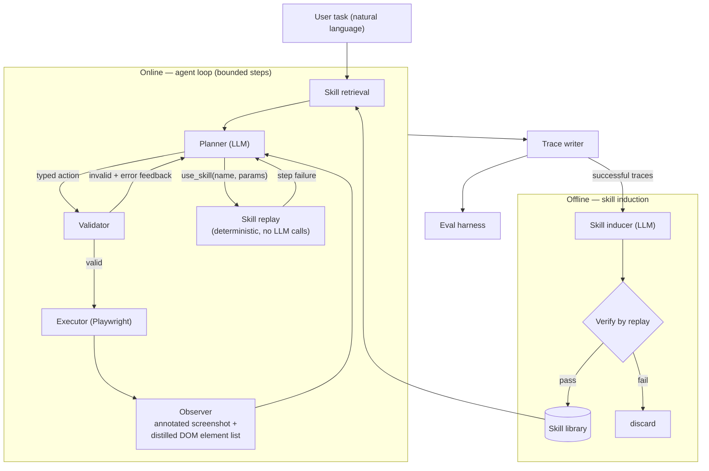

# web-action-agent

A self-improving multimodal web action agent.

It takes a natural-language task — *"Search Hacker News for 'Rust async' and
open the top result"* — perceives the page through both its DOM and an
annotated screenshot, decides the next action with an LLM planner, executes it
via Playwright, and self-evaluates on a small benchmark. Successful runs are
distilled into reusable, verified skills, so repeated tasks get cheaper, faster,
and more reliable over time.

> **Status: early scaffold.** The agent loop is not implemented yet. This
> repository currently contains the project skeleton only.

## How it works



Every decision is grounded: interactive elements are numbered once and those
same numbers appear in both the DOM listing and the screenshot overlay
(Set-of-Marks), so the planner can never be ambiguous about what it is clicking.
Every action is typed and passes a validator before it reaches the browser.
Every run — success or failure — writes a self-contained artifact folder with
annotated screenshots, an action log, cost accounting, and a verdict.

## Requirements

- Python 3.11+
- Playwright with Chromium
- To run a task: an OpenAI-compatible LLM endpoint (base URL, API key, model
  name). Installing and testing needs neither an endpoint nor an account.

## Install

```bash
uv sync                              # creates .venv from uv.lock
uv run playwright install chromium
```

Or with pip and no `uv` at all:

```bash
python -m venv .venv && . .venv/bin/activate
pip install -r requirements.txt      # pinned, and installs this package
playwright install chromium
```

## Usage

```bash
waa run "Search Hacker News for 'Rust async' and open the top result"
```

`waa` is the short alias; `web-action-agent` works identically.

| Command | Purpose |
|---|---|
| `waa run "<task>"` | Run one task end to end |
| `waa eval` | Run the benchmark suite with layered verdicts |
| `waa induce <run-folder>` | Distill successful traces into candidate skills |
| `waa skills list \| show \| retire` | Inspect and curate the skill library |
| `waa judge <runs-dir>` | Produce verdicts and the agreement report |

Add `--help` to any of them for its flags. Every run starts from an explicit
URL — `--start-url`, or the `start_url` default — because the agent never
begins on a blank page and guesses. `--headed` shows the browser window; it is
off by default so runs work over SSH and in CI.

### Exit codes

| Code | Meaning |
|---|---|
| `0` | It worked |
| `1` | The command ran and the work did not succeed — a task the agent could not complete |
| `2` | The command could not be run at all — an unknown flag, a bad setting |

The difference between `1` and `2` is there to be used: a benchmark script
records a failed task and carries on, but stops on `2`, since a mistyped flag
of its own would be repeated by every remaining invocation.

## Configuration

The model endpoint is pure configuration — base URL, API key, and model name.
The same code runs unmodified against a hosted aggregator, a first-party
provider endpoint, or a local vLLM deployment. Copy `.env.example` to `.env`
and fill in the values.

Endpoints are described in `src/web_action_agent/profiles.yaml` as named
*profiles*: base URL, the variable holding the key, the text model, and the
vision-language model used when an observation carries a screenshot. Three ship
— `openrouter`, `nvidia`, and `local` — and one is selected per run with
`--profile`. Where an aggregator routes one model to several hosts, the profile
pins the host, so a benchmark number can be reproduced later.

Settings resolve in three layers, lowest precedence first: `config.yaml` for
the checked-in defaults, `.env` for machine-local overrides and every secret,
then command-line flags. `.env` is gitignored; an API key is never read from
`config.yaml`, and a setting there whose name says it holds one is rejected by
name with a message pointing at `.env`. `.env.example` lists every variable the
agent reads, with names and defaults but no values.

### What your keys make available

No account is needed to read, install, or test this project: the offline suite
runs on a local static site with no network and no key. Only running a task
needs an endpoint. Every command prints, before it does anything, what the keys
it found actually enable:

```
capabilities:
  [ok] agent    profile 'openrouter' -> nvidia/nemotron-3-nano-30b-a3b
  [ok] vision   screenshots go to nvidia/nemotron-3-nano-omni-30b-a3b
  [--] judge    no judge endpoint: set WAA_JUDGE_PROFILE, ...
```

Nothing there is fatal. Running tasks needs the agent endpoint; reproducing the
published evaluation additionally needs a judge, which is deliberately a
different model family from the planner. A missing judge is a line in the
report rather than an error, so the failure it prevents — a benchmark that
quietly skipped grading — cannot happen unnoticed.

The report names variables, never values. Keys are read from the environment
and `.env` alone, and every message the agent prints, logs, or writes into a
run's trace is scrubbed of them first.

## Development

A `uv`-managed `.venv` is the development environment; a system or user Python
is never used directly.

```bash
git config core.hooksPath .githooks   # required once per clone
uv venv                               # Python from .python-version
uv sync                               # runtime + dev dependencies, from uv.lock
uv run pytest
```

Every command runs through `uv run`, or inside the activated `.venv`.

Dependencies are declared in `pyproject.toml` and pinned in `uv.lock`.
`requirements.txt` is generated from that lockfile — never edited by hand — and
regenerated whenever the lockfile changes:

```bash
uv export --format requirements-txt --no-hashes --no-dev --no-editable -o requirements.txt
```

### Tests

Every test declares what it needs to run, with exactly one marker. Collection
fails if a test declares none, or more than one — the marker is what decides
whether continuous integration runs it, so an unmarked test is one nobody is
running.

| Marker | Needs |
|---|---|
| `unit` | Nothing — pure Python, no browser and no network |
| `fixture` | The static HTML site in `tests/fixtures/site/`, served locally |
| `mock_llm` | Stubbed or recorded model responses |
| `live` | The real web or a real model endpoint |

```bash
uv run pytest                      # everything except live
uv run pytest -m unit              # one kind
uv run pytest -m live              # opt in explicitly; needs network and a key
```

A bare `uv run pytest` excludes `live`, so the default run is offline, free,
and needs no API key.

### Continuous integration

Pull requests run three jobs: `ruff check` and `ruff format --check`; the
offline suite (`unit or fixture or mock_llm`) against a cached Chromium; and an
install from `requirements.txt` into a plain virtual environment on a runner
with no `uv`, which is what keeps the lockfile and the exported manifest from
drifting apart. The test job asserts up front that its selection reaches no
`live` test, and prints both counts.

## Safety

- Closed action space — no arbitrary code or script execution path
- A validator gates every action before it reaches the browser
- Domain allowlist enforced on all navigation
- Configurable hard step cap per run
- No login-gated, transactional, or destructive interactions

Each run may visit the *registrable domain* of its start URL — `nlb.gov.sg` for
a run starting on `catalogue.nlb.gov.sg`, never the whole of `gov.sg` — plus
any domains in `allowlist_extra` and any the task itself declares. The boundary
is computed from a packaged copy of the Public Suffix List, so a lookalike, or
a neighbour registered under the same multi-part ending, is refused. The list
is fixed before the first step; going anywhere else is a correctable error
handed back to the planner, not a crash.

## License

MIT — see [LICENSE](LICENSE).
