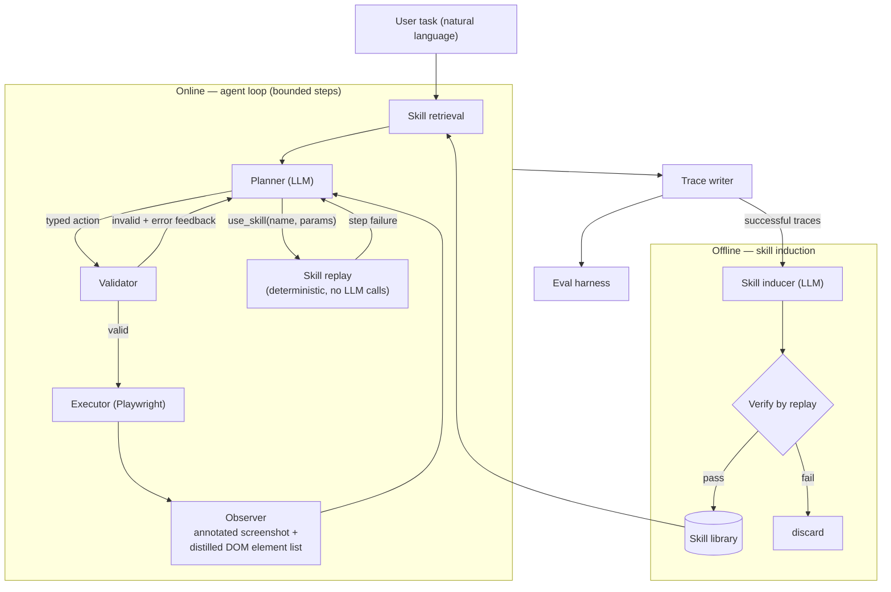
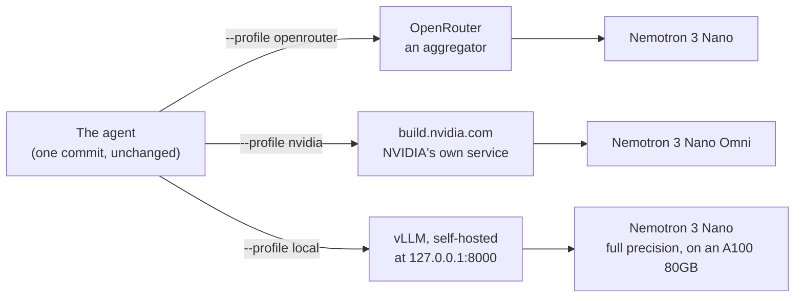

# web-action-agent

A self-improving multimodal web action agent.

It takes a natural-language task — *"Search Hacker News for 'Rust async' and
open the top result"* — perceives the page through both its DOM and an
annotated screenshot, decides the next action with an LLM planner, executes it
via Playwright, and self-evaluates on a small benchmark. Successful runs are
distilled into reusable, verified skills, so repeated tasks get cheaper, faster,
and more reliable over time.

> **Status: early scaffold.** The agent loop is not implemented yet. This
> repository currently contains the project skeleton only.

## How it works



Every decision is grounded: interactive elements are numbered once and those
same numbers appear in both the DOM listing and the screenshot overlay
(Set-of-Marks), so the planner can never be ambiguous about what it is clicking.
Every action is typed and passes a validator before it reaches the browser.
Every run — success or failure — writes a self-contained artifact folder with
annotated screenshots, an action log, cost accounting, and a verdict.

## Requirements

- Python 3.11+
- Playwright with Chromium
- To run a task: an OpenAI-compatible LLM endpoint (base URL, API key, model
  name). Installing and testing needs neither an endpoint nor an account.

## Install

```bash
uv sync                              # creates .venv from uv.lock
uv run playwright install chromium
```

Or with pip and no `uv` at all:

```bash
python -m venv .venv && . .venv/bin/activate
pip install -r requirements.txt      # pinned, and installs this package
playwright install chromium
```

## Usage

```bash
waa run "Search Hacker News for 'Rust async' and open the top result"
```

`waa` is the short alias; `web-action-agent` works identically.

| Command | Purpose |
|---|---|
| `waa run "<task>"` | Run one task end to end |
| `waa eval` | Run the benchmark suite with layered verdicts |
| `waa induce <run-folder>` | Distill successful traces into candidate skills; `--all <sweep-folder>` learns from a benchmark sweep's passes |
| `waa skills list \| show \| retire` | Inspect and curate the skill library |
| `waa judge <runs-dir>` | Produce verdicts and the agreement report |
| `waa judge --review [runs-dir]` | Check the machine's marks by hand, one run at a time; resumable |

Add `--help` to any of them for its flags. Every run starts from an explicit
URL — `--start-url`, or the `start_url` default — because the agent never
begins on a blank page and guesses. `--headed` shows the browser window; it is
off by default so runs work over SSH and in CI.

### The cold-vs-warm experiment

Does learning skills make the agent better? `scripts/cold_vs_warm.sh` answers
it on one model: the benchmark with an empty skill library, then learning from
that pass's passing trials, then the benchmark again with what was learnt.

```bash
uv run scripts/cold_vs_warm.sh --profile openrouter --trials 3
```

It spends real money and visits the benchmark's live sites; each pass has its
own spending and time ceiling. Run it again to resume after a stop. The two
passes are compared, with the change in success rate, steps, tokens, time and
cost, in `results/cold_vs_warm.md`. A cold pass refuses to start on a library
that holds skills, and a warm pass on one with none for the suite's sites, so
neither arm can quietly be the other.

### The multi-model comparison

Is the agent any good only on the model it was built with? `scripts/multi_model.sh`
runs the same benchmark, cold, on several models one after another, changing
nothing but `--profile`:

```bash
uv run scripts/multi_model.sh                       # the three profiles below, 2 trials each
uv run scripts/multi_model.sh --profiles "a b" --trials 1
```

It refuses to start while the code has uncommitted changes, and every sweep
records the commit it ran, so `results/multi_model.md` can check, rather than
assert, that only the model changed. The first comparison, on the live sites on
19 October 2026:

| Profile | Model (planner and screenshots) | N | Success rate | Avg steps | Avg time | Avg cost per trial |
|---|---|---|---|---|---|---|
| `openrouter` | `nvidia/nemotron-3-nano-30b-a3b` (screenshots: `nvidia/nemotron-3.5-super-vl`) | 24 (12 tasks × 2) | 41.7% | 10.8 | 78 s | $0.0042 |
| `openrouter-qwen` | `qwen/qwen3.6-35b-a3b` | 24 (12 tasks × 2) | 33.3% | 12.6 | 173 s | $0.0174 |
| `openrouter-glimmer` | `meta/muse-glimmer-30b` | 24 (12 tasks × 2) | 33.3% | 13.0 | 186 s | $0.0127 |

All three ran commit `910e4ad`, with nothing uncommitted, the same suite, the
same judge and an empty skill library. Three models of about the same size,
from three makers, land within two trials of each other, and the same six tasks
(the MOE school finder and the MOM pages) defeat all three: those failures
belong to the agent and the sites, not to one model. The main model is also the
cheapest, by three to four times, and the fastest, by more than two. With two trials per task
these figures are rough; the per-task results are in `results/multi_model.md`.

### The endpoint modes: same code, three ways to reach a model

The agent never names a model or a service in its code. Both come from a
profile, a few lines of configuration picked with `--profile`. So the same code
runs against an aggregator, the model maker's own service, or a server you run
yourself, and nothing else changes. That is checked, not claimed: on
20 October 2026 one benchmark task ran once through each of the three, all on
one commit, with nothing uncommitted.



| Profile | Service | Model | Passed | Time | Tokens | Cost |
|---|---|---|---|---|---|---|
| `openrouter` | OpenRouter | `nvidia/nemotron-3-nano-30b-a3b` (screenshots: `nvidia/nemotron-3.5-super-vl`) | 1 of 1 | 31.3 s | 6,411 | $0.0007 |
| `nvidia` | build.nvidia.com | `nvidia/nemotron-3-nano-omni-30b-a3b-reasoning` | 1 of 1 | 11.0 s | 2,685 | unknown (free trial access) |
| `local` | vLLM on a rented A100 80GB, reached through an SSH tunnel | `nvidia/nemotron-3-nano-30b-a3b` (text only) | 1 of 1 | 3.9 s | 2,607 | unknown (self-hosted) |

Every check in `results/endpoint_modes.md` reads yes: the same commit
(`6decfca`) with nothing uncommitted in every arm, the same task, the same
judge, an empty skill library, and a different service for each. The
self-hosted arm has no per-token price, so it reports tokens and time, and its
dollars as unknown rather than zero; the GPU it ran on cost about $0.85 for the
session. (The build.nvidia.com profile uses Nano's Omni sibling: the text-only
Nano was retired there on 2026-09-01.)

To run it yourself:

```bash
uv run scripts/endpoint_modes.sh                     # openrouter, nvidia and local
uv run scripts/endpoint_modes.sh --profiles nvidia   # just one
```

| Profile | Key in `.env` |
|---|---|
| `openrouter` | `WAA_OPENROUTER_API_KEY` |
| `nvidia` | `WAA_NVIDIA_API_KEY` |
| `local` | none |

The `local` profile expects a vLLM server at `http://127.0.0.1:8000/v1`,
serving Nemotron 3 Nano under the name the profile asks for. The full-precision
model needs an 80 GB GPU (A100 or H100). Install vLLM 0.12 or later into its
own environment (on a recent Ubuntu, the system Python refuses `pip install`),
fetch the reasoning parser from the model's Hugging Face page, and serve:

```bash
uv venv venv && uv pip install --python venv/bin/python "vllm>=0.12.0"
wget https://huggingface.co/nvidia/NVIDIA-Nemotron-3-Nano-30B-A3B-BF16/resolve/main/nano_v3_reasoning_parser.py
VLLM_USE_FLASHINFER_SAMPLER=0 venv/bin/vllm serve nvidia/NVIDIA-Nemotron-3-Nano-30B-A3B-BF16 \
  --trust-remote-code \
  --reasoning-parser-plugin nano_v3_reasoning_parser.py \
  --reasoning-parser nano_v3 --max-model-len 32768 --port 8000 \
  --served-model-name nvidia/nemotron-3-nano-30b-a3b
```

`VLLM_USE_FLASHINFER_SAMPLER=0` is needed only where FlashInfer's prebuilt
kernels are missing and it cannot compile them (no `ninja` or `nvcc`); without
it, such a server stops at its first request. NVIDIA also publishes an 8-bit
version (`...-FP8`, 33 GB instead of 63 GB) for H100-class GPUs.

The server can be on another machine, such as a rented GPU: an SSH tunnel
(`ssh -N -L 8000:localhost:8000 <gpu-host>`) makes it appear on port 8000
here, and the profile stays as it is.

### DOM only vs. DOM + screenshots

The agent reads each page as text: the numbered list of things it can click,
and the page's words. It adds an annotated screenshot only when a cheap rule
says the text may be missing something: too few elements found, or the
planner failing on text twice in a row. What does that screenshot buy?
`scripts/dom_vs_dual.sh` runs the benchmark twice on the same planner model,
once as usual and once on `openrouter-text`, the same profile with no
screenshot model, so no image can be sent at all:

```bash
uv run scripts/dom_vs_dual.sh                 # both arms, 2 trials per task
```

The first run, on the live sites on 20 October 2026:

| | DOM only | DOM + screenshots when gated in | Change |
|---|---|---|---|
| Trials passed (N = 24, 12 tasks × 2) | 10 (41.7%) | 11 (45.8%) | +1 trial |
| Model calls that carried an image | 0 of 256 | 68 of 235, in 4 trials | |
| Average cost per trial | $0.0029 | $0.0032 | +10% |
| Average tokens per trial | 24,966 | 26,036 | +4% |
| Average time per trial | 77.1 s | 67.9 s | −12% |

Both arms ran commit `b9f8954` with nothing uncommitted, and every request of
the text-only arm was checked: none carried an image. The rule kept
screenshots rare: they were sent in 4 trials of 24, on three tasks. They
plausibly bought one pass (`cpf-total-rate`, 0/2 → 1/2); on the two Ministry
of Manpower tasks, 53 image calls between them changed nothing. On tasks where
no image was sent at all, two results moved in opposite directions by chance,
which is as large as the whole difference. On this suite, then, the
screenshot channel costs little and buys little: the tasks the agent fails
are not failed for want of seeing the page. The per-task results are in
`results/dom_vs_dual.md`.

### Exit codes

| Code | Meaning |
|---|---|
| `0` | It worked |
| `1` | The command ran and the work did not succeed — a task the agent could not complete |
| `2` | The command could not be run at all — an unknown flag, a bad setting |

The difference between `1` and `2` is there to be used: a benchmark script
records a failed task and carries on, but stops on `2`, since a mistyped flag
of its own would be repeated by every remaining invocation.

## Configuration

The model endpoint is pure configuration — base URL, API key, and model name.
The same code runs unmodified against a hosted aggregator, a first-party
provider endpoint, or a local vLLM deployment. Copy `.env.example` to `.env`
and fill in the values.

Endpoints are described in `src/web_action_agent/profiles.yaml` as named
*profiles*: base URL, the variable holding the key, the text model, and the
vision-language model used when an observation carries a screenshot. Three ship
— `openrouter`, `nvidia`, and `local` — and one is selected per run with
`--profile`. Where an aggregator routes one model to several hosts, the profile
pins the host, so a benchmark number can be reproduced later.

Settings resolve in three layers, lowest precedence first: `config.yaml` for
the checked-in defaults, `.env` for machine-local overrides and every secret,
then command-line flags. `.env` is gitignored; an API key is never read from
`config.yaml`, and a setting there whose name says it holds one is rejected by
name with a message pointing at `.env`. `.env.example` lists every variable the
agent reads, with names and defaults but no values.

### What your keys make available

No account is needed to read, install, or test this project: the offline suite
runs on a local static site with no network and no key. Only running a task
needs an endpoint. Every command prints, before it does anything, what the keys
it found actually enable:

```
capabilities:
  [ok] agent    profile 'openrouter' -> nvidia/nemotron-3-nano-30b-a3b
  [ok] vision   screenshots go to nvidia/nemotron-3.5-super-vl
  [--] judge    no judge endpoint: set WAA_JUDGE_PROFILE, ...
```

Nothing there is fatal. Running tasks needs the agent endpoint; reproducing the
published evaluation additionally needs a judge, which is deliberately a
different model family from the planner. A missing judge is a line in the
report rather than an error, so the failure it prevents — a benchmark that
quietly skipped grading — cannot happen unnoticed.

The report names variables, never values. Keys are read from the environment
and `.env` alone, and every message the agent prints, logs, or writes into a
run's trace is scrubbed of them first.

## Development

A `uv`-managed `.venv` is the development environment; a system or user Python
is never used directly.

```bash
git config core.hooksPath .githooks   # required once per clone
uv venv                               # Python from .python-version
uv sync                               # runtime + dev dependencies, from uv.lock
uv run pytest
```

Every command runs through `uv run`, or inside the activated `.venv`.

Dependencies are declared in `pyproject.toml` and pinned in `uv.lock`.
`requirements.txt` is generated from that lockfile — never edited by hand — and
regenerated whenever the lockfile changes:

```bash
uv export --format requirements-txt --no-hashes --no-dev --no-editable -o requirements.txt
```

### Tests

Every test declares what it needs to run, with exactly one marker. Collection
fails if a test declares none, or more than one — the marker is what decides
whether continuous integration runs it, so an unmarked test is one nobody is
running.

| Marker | Needs |
|---|---|
| `unit` | Nothing — pure Python, no browser and no network |
| `fixture` | The static HTML site in `tests/fixtures/site/`, served locally |
| `mock_llm` | Stubbed or recorded model responses |
| `live` | The real web or a real model endpoint |

```bash
uv run pytest                      # everything except live
uv run pytest -m unit              # one kind
uv run pytest -m live              # opt in explicitly; needs network and a key
```

A bare `uv run pytest` excludes `live`, so the default run is offline, free,
and needs no API key.

### Continuous integration

Pull requests run three jobs: `ruff check` and `ruff format --check`; the
offline suite (`unit or fixture or mock_llm`) against a cached Chromium; and an
install from `requirements.txt` into a plain virtual environment on a runner
with no `uv`, which is what keeps the lockfile and the exported manifest from
drifting apart. The test job asserts up front that its selection reaches no
`live` test, and prints both counts.

## Safety

- Closed action space — no arbitrary code or script execution path
- A validator gates every action before it reaches the browser
- Domain allowlist enforced on all navigation
- Configurable hard step cap per run
- No login-gated, transactional, or destructive interactions

Each run may visit the *registrable domain* of its start URL — `nlb.gov.sg` for
a run starting on `catalogue.nlb.gov.sg`, never the whole of `gov.sg` — plus
any domains in `allowlist_extra` and any the task itself declares. The boundary
is computed from a packaged copy of the Public Suffix List, so a lookalike, or
a neighbour registered under the same multi-part ending, is refused. The list
is fixed before the first step; going anywhere else is a correctable error
handed back to the planner, not a crash.

## License

MIT — see [LICENSE](LICENSE).
