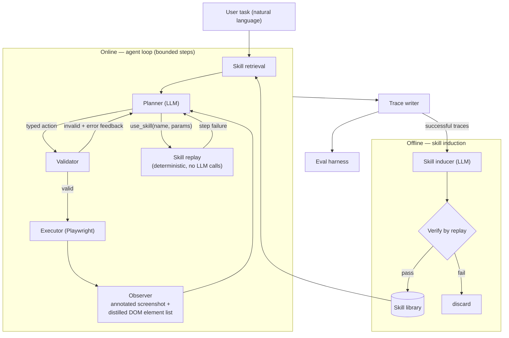

# web-action-agent

A self-improving multimodal web action agent.

It takes a natural-language task — *"Search Hacker News for 'Rust async' and
open the top result"* — perceives the page through both its DOM and an
annotated screenshot, decides the next action with an LLM planner, executes it
via Playwright, and self-evaluates on a small benchmark. Successful runs are
distilled into reusable, verified skills, so repeated tasks get cheaper, faster,
and more reliable over time.

> **Status: early scaffold.** The agent loop is not implemented yet. This
> repository currently contains the project skeleton only.

## How it works



Every decision is grounded: interactive elements are numbered once and those
same numbers appear in both the DOM listing and the screenshot overlay
(Set-of-Marks), so the planner can never be ambiguous about what it is clicking.
Every action is typed and passes a validator before it reaches the browser.
Every run — success or failure — writes a self-contained artifact folder with
annotated screenshots, an action log, cost accounting, and a verdict.

## Requirements

- Python 3.11+
- Playwright with Chromium
- An OpenAI-compatible LLM endpoint (base URL, API key, model name)

## Install

```bash
uv sync                              # creates .venv from uv.lock
uv run playwright install chromium
```

Or with pip and no `uv` at all:

```bash
python -m venv .venv && . .venv/bin/activate
pip install -r requirements.txt      # pinned, and installs this package
playwright install chromium
```

## Usage

```bash
waa run "Search Hacker News for 'Rust async' and open the top result"
```

`waa` is the short alias; `web-action-agent` works identically.

| Command | Purpose |
|---|---|
| `waa run "<task>"` | Run one task end to end |
| `waa eval` | Run the benchmark suite with layered verdicts |
| `waa induce <run-folder>` | Distill successful traces into candidate skills |
| `waa skills list \| show \| retire` | Inspect and curate the skill library |
| `waa judge <runs-dir>` | Produce verdicts and the agreement report |

## Configuration

The model endpoint is pure configuration — base URL, API key, and model name.
The same code runs unmodified against a hosted aggregator, a first-party
provider endpoint, or a local vLLM deployment. Copy `.env.example` to `.env`
and fill in the values.

## Development

A `uv`-managed `.venv` is the development environment; a system or user Python
is never used directly.

```bash
git config core.hooksPath .githooks   # required once per clone
uv venv                               # Python from .python-version
uv sync                               # runtime + dev dependencies, from uv.lock
uv run pytest
```

Every command runs through `uv run`, or inside the activated `.venv`.

Dependencies are declared in `pyproject.toml` and pinned in `uv.lock`.
`requirements.txt` is generated from that lockfile — never edited by hand — and
regenerated whenever the lockfile changes:

```bash
uv export --format requirements-txt --no-hashes --no-dev --no-editable -o requirements.txt
```

Tests run against the static HTML fixture site in `tests/fixtures/` — no live
web traffic and no API keys required.

## Safety

- Closed action space — no arbitrary code or script execution path
- A validator gates every action before it reaches the browser
- Domain allowlist enforced on all navigation
- Configurable hard step cap per run
- No login-gated, transactional, or destructive interactions

## License

MIT — see [LICENSE](LICENSE).
