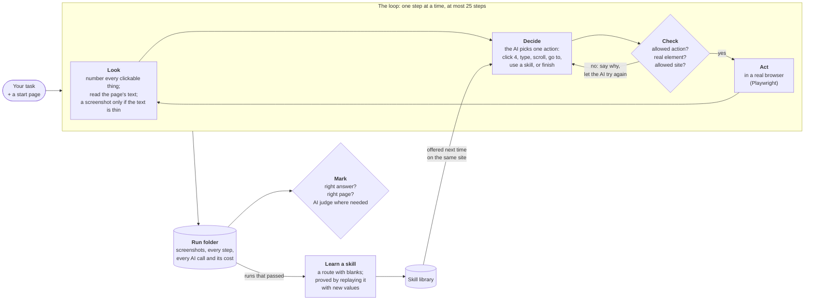
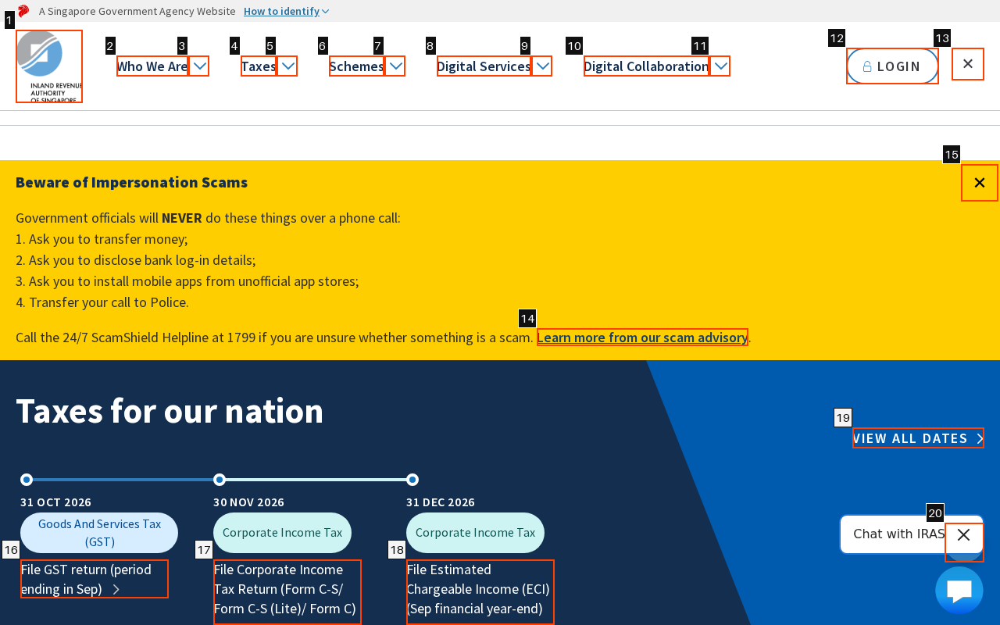
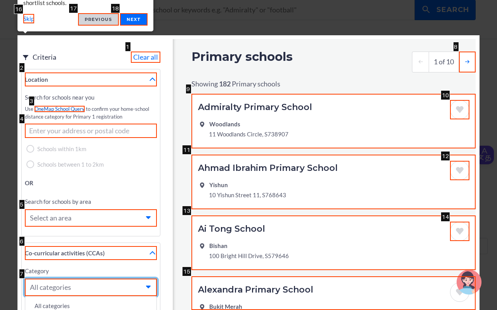
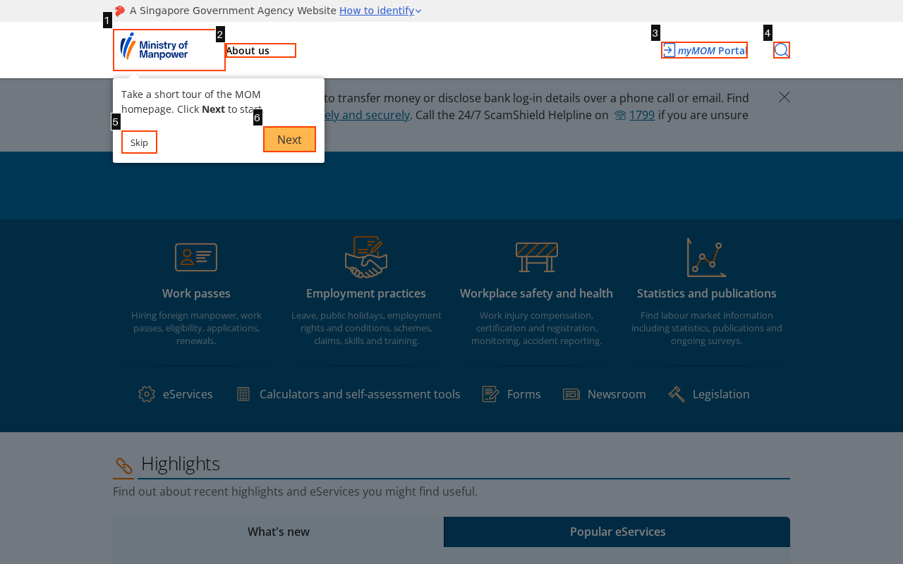
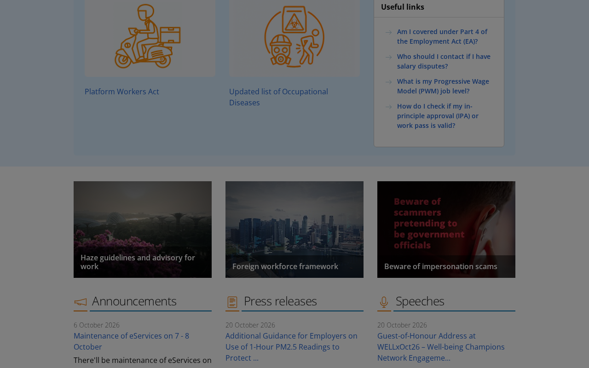

<h1 align="center">web-action-agent</h1>

<p align="center">
  <b>An AI agent that uses real websites the way a person does:<br/>
  it reads the page, decides what to click, checks its own work,<br/>
  and learns shortcuts from the runs that go well.</b>
</p>

<p align="center">
  <a href="https://github.com/edangx100/web-action-agent/actions/workflows/ci.yml"></a>
  
  
  <a href="LICENSE"></a>
</p>

<p align="center">
  <a href="#demo">Demo</a> ·
  <a href="#results-at-a-glance">Results</a> ·
  <a href="#how-it-works">How it works</a> ·
  <a href="#quick-start">Quick start</a> ·
  <a href="#why-tasks-fail">Why tasks fail</a> ·
  <a href="#reference">Reference</a>
</p>

---

You give it a task in plain words and a page to start on. It works through the
site one step at a time (click, type, scroll) until it has the answer, then
stops. Everything it saw and did is saved, so any run can be checked later.

Three ideas set it apart:

- **It sees exactly what it can click.** Every clickable thing on the page gets
  a number, drawn on the screenshot and listed in the page's text, so the AI
  answers "click 4", never "click the blue button somewhere on the left".
- **It is marked, not trusted.** Every task comes with checks that a program
  runs on the finished run: the right answer, on the right page. An agent that
  says "done" with the wrong answer is caught. It happens: see the demo.
- **It learns.** A run that worked can be turned into a reusable *skill*, a
  saved route with blanks for the details, proved on the live site before it
  is kept. Next time the agent replays it with almost no AI calls.

## Demo


**What you are watching:** the agent answering a question by finding its way
around a real government website, with no person touching the mouse.

**The question it was given.** In everyday words: *"In Singapore, if your
taxable income for the year is $80,000, how much income tax do you pay?"* It is
not allowed to answer from memory. It starts on the home page of IRAS, the
Inland Revenue Authority of Singapore (the country's tax office), and has to
find the answer on the site. The exact wording it was given is:

> Starting from the IRAS home page, find the individual income tax rates for
> tax residents. Using the rates that apply from Year of Assessment 2024
> onwards, report the gross tax payable on the first $80,000 of chargeable
> income.

**Where the answer is.** Singapore taxes income in slices, each at its own
rate. The IRAS rates page has a table like this one, and the answer is in it:

| Slice of income | Rate | Tax on that slice | Total tax so far |
|---|---|---|---|
| First $20,000 | 0% | $0 | $0 |
| Next $10,000 | 2% | $200 | $200 |
| Next $10,000 | 3.5% | $350 | $550 |
| Next $40,000 (up to $80,000) | 7% | $2,800 | **$3,350** |
| Next $40,000 (up to $120,000) | 11.5% | $4,600 | $7,950 |

So the right answer is **$3,350**.

**What the agent did,** in five steps (the GIF shows each one):

1. Clicked **Taxes** in the top menu, which opens a menu on the same page.
2. Clicked **Individual Income Tax** in that menu.
3. Clicked **Tax residency and tax rates**, which opens that page.
4. Clicked the card **Individual Income Tax rates**, which opens the rates page.
5. Read the table and answered **3350**.

**How we know it got it right.** Not because the agent said so. This task
comes with two checks that a program runs on the finished run: the answer must
be $3,350 (written any of the usual ways), and the run must end on the rates
page. Both passed. That matters: a different AI model, given the same task,
found the same table, read the row below, answered $4,600, and still reported
success. The checks caught it.

The run started with no skills learned from earlier runs, as on a fresh copy
of this project. It took five calls to the AI and cost $0.003. Waits for the AI
are shortened in the GIF; the clicks play in real time.

<details>
<summary><b>The same run in the terminal, and how the demo is made</b></summary>

<br/>

The terminal side of the same run, one line per step, is in
[`docs/demo.cast`](docs/demo.cast), an [asciinema](https://asciinema.org)
recording:

```bash
uv run --extra demo asciinema play docs/demo.cast
```

```
  1  act    click [4] link "Taxes" -> ok (0.21s)
  2  act    click [8] link "Individual Income Tax" -> ok (0.14s)
  3  act    click [39] link "Tax residency and tax rates" -> ok (0.52s)
  4  act    click [19] link "Individual Income Tax rates View individual income tax rates ..." -> ok (0.40s)
  5  done   success: 3350

5 calls, 20,161 tokens, $0.0030, 96.7s thinking
success in 5 steps: 3350 (exit 0)
```

Both recordings come from one run of `scripts/demo.sh`, which records a fresh
run and replaces them only if the run passes the task's checks (`--help` for
details).

</details>

**See everything a run leaves behind.** [`runs/example/`](runs/example/) is
one complete run of the same task, committed to the repository: a screenshot of
every step with the numbered boxes the agent saw, every decision, every AI call
and its cost, and the final mark. Its [README](runs/example/README.md) walks
through it step by step.

## Results at a glance

All results are from the project's own benchmark: **12 tasks on 5 Singapore
government websites** (the Ministry of Manpower, the Ministry of Education,
IRAS, the statistics department SingStat, and the CPF Board, which runs the
national savings scheme), run on
the live sites in October 2026, each task several times. The AI behind the
agent is NVIDIA's open **Nemotron 3 Nano** model unless a row says otherwise.

| Question | Answer | Details |
|---|---|---|
| Does learning skills help? | **Yes.** Success rose from **33% to 53%**. On the three tasks a skill was learned for, **6 of 9 → 9 of 9** passes, in **82% fewer steps**. | [Learning skills](#1-does-learning-skills-help) |
| Is it tied to one AI model? | **No.** Three models from three makers scored **42%, 33% and 33%**, and the same tasks defeated all three. | [Three AI models](#2-three-ai-models) |
| Does it need one particular AI service? | **No.** The same code passed through an AI marketplace, NVIDIA's own service, and a server we ran ourselves, **3 of 3**. | [Three AI services](#3-three-ways-to-reach-the-ai) |
| Do screenshots help? | **Barely, on these sites.** Reading pages as text alone passed 10 of 24 trials; adding screenshots when needed, 11 of 24, for **10% more cost**. | [Screenshots](#4-what-screenshots-buy) |
| Does the AI judge agree with a person? | **Not measured yet.** The tool is built; the hand labels are still to be done. | [The judge](#5-the-judge-and-a-person) |

Each sweep's full tables, task by task, are in [`results/`](results/README.md).

## How it works



**Look.** The agent never hands the AI a raw web page. It lists only what a
person could click on the visible screen, numbers each item, and draws the same
numbers onto the screenshot (a technique called *Set-of-Marks*), alongside the
page's main text. This is what the AI sees on the IRAS home page:

<p align="center">
  
</p>

To keep costs down, the screenshot goes to the AI only when the text looks
insufficient: fewer than five clickable things found, or two failures in a row
on text alone. Most steps use text only.

**Decide.** The AI chooses exactly one of seven actions, in a fixed format, so
there is no free-form text to misread and no way for it to run code. It sees
its last five steps in full and a short summary of anything older.

**Check.** Before anything reaches the browser, a validator checks the action:
the right format, an element number that exists on this page, a site the run
is allowed to visit. A bad action goes back to the AI with the reason, a fixed
number of times.

**Act.** One real Chromium browser, a fresh private session for every task,
and good manners: at least a second between visits to a site, an honest name in
every request, and the site's `robots.txt` obeyed.

**Mark.** Every finished run is marked in layers. First, checks that need no AI
at all (did it end on the right address, give the right answer, show the right
text). Then, where an answer cannot be checked by code, a second and stronger
AI from a different maker. And a person can spot-check the machine's marks, one
run at a time, to measure how far to trust them.
Every failure is given one of four causes, so a failure rate becomes a list of
things to fix:

| Cause | Meaning |
|---|---|
| **Grounding** | the right idea, the wrong thing on the page (typed into the wrong box) |
| **Planning** | the wrong idea (skipped a step, gave up early, guessed) |
| **Navigation** | lost between pages (went in circles, guessed addresses) |
| **Site change** | the website changed under the task |

**Learn.** A run that passed can be turned into a skill: the same route, with
blanks where the task's details were. A skill is only kept after it has been
replayed with *different* values on the live site and worked. When a task
starts on a site with skills, they are offered to the AI; replaying one costs
the single AI call that chose it.

## Quick start

### 1. Install

You need Python 3.11+ and [`uv`](https://docs.astral.sh/uv/).

```bash
git clone https://github.com/edangx100/web-action-agent.git
cd web-action-agent
uv sync                              # creates .venv from uv.lock
uv run playwright install chromium   # the browser the agent drives
```

No `uv`? `pip install -r requirements.txt` in a virtual environment works too,
then `playwright install chromium`.

### 2. Check it works, with no account at all

```bash
uv run pytest                        # ~1,600 tests, offline, no API key
```

The tests use a small practice website served from your own machine, so they
need no network, no key and no money.

### 3. What you need for each part

| To | You need |
|---|---|
| Read the code, install, run the tests | **Nothing.** No account, no key. |
| Run the agent on a task (`waa run`) | **One AI endpoint**: any OpenAI-compatible service. The simplest is an [OpenRouter](https://openrouter.ai) key. An NVIDIA key, or a server you run yourself, also work. |
| Reproduce the benchmark and its marks (`waa eval`) | The above, **plus a judge endpoint**. The suggested judge runs on the same OpenRouter key, so no second account. |
| Look at runs in Opik (optional) | An [Opik](https://github.com/comet-ml/opik) key, or Opik running on your own machine. |

Put the key in a file called `.env` (copy `.env.example` and fill it in):

```bash
WAA_OPENROUTER_API_KEY=sk-or-...        # to run the agent
WAA_JUDGE_PROFILE=openrouter-judge      # to mark benchmark runs (same key)
```

Keys stay in `.env`, which git ignores, and the program never prints them.
Every command starts by saying what your keys allow:

```
capabilities:
  [ok] agent    profile 'openrouter' -> nvidia/nemotron-3-nano-30b-a3b
  [ok] vision   screenshots go to nvidia/nemotron-3.5-super-vl
  [ok] judge    profile 'openrouter-judge' -> google/gemini-3.8-flash
```

### 4. Run a task

```bash
uv run waa run --start-url https://www.iras.gov.sg/ \
  "Find the individual income tax rates for tax residents and report the gross tax payable on the first \$80,000 of chargeable income."
```

You will see one line per step, then the answer. Add `--headed` to watch the
browser window. The run's full record lands in a new folder under `runs/`.

A run costs a fraction of a cent on the default model (about $0.002–$0.005).

### 5. Run the benchmark

```bash
uv run waa eval --cold --trials 1      # all 12 tasks once, no learned skills
```

It runs four tasks at a time, stays under a spending ceiling ($15 by default),
can be stopped and restarted where it left off, and writes its tables to
`results/`.

## Results

The benchmark is 12 read-only tasks on 5 Singapore government websites: three
that find an answer on one page, three that fill in a search form, and six that
need several pages. Each was checked against the live site, and each site's
terms of use allow an automated, read-only visitor. Every number below comes
from runs on the live sites in October 2026. Trials per task are small (two or
three), so read differences of a trial or two as noise.

### 1. Does learning skills help?

The benchmark ran twice on the same model: **cold**, with no skills, then
**warm**, with the three skills learned from the cold run's passes.

| | Cold (no skills) | Warm (3 learned skills) |
|---|---|---|
| Success rate, all 12 tasks (3 trials each) | 33.3% | **52.8%** |
| …on the 3 tasks a skill was used for | 6 of 9, 11.1 steps | **9 of 9, 2.0 steps** |
| …on the 9 tasks with no skill | 6 of 27 | 10 of 27 |
| Average cost per trial | $0.0042 | $0.0030 |

Read the split, not just the headline. Where a skill applied, every trial
passed, in a fifth of the steps. The other nine tasks ran exactly as before,
yet still went from 6 to 10 passes: that is how much results move between runs
by chance, and it is a reason not to quote the headline alone.
[Full table](results/cold_vs_warm.md) · `scripts/cold_vs_warm.sh`

### 2. Three AI models

The same benchmark, cold, on three similar-sized open models from three makers,
changing nothing but one setting. Every run recorded the exact code version, so
the table can check that only the model changed.

| Model | Maker | Passed (24 trials) | Avg time per trial | Avg cost per trial |
|---|---|---|---|---|
| Nemotron 3 Nano 30B | NVIDIA | **10 (41.7%)** | 78 s | **$0.0042** |
| Qwen 3.6 35B | Alibaba | 8 (33.3%) | 173 s | $0.0174 |
| Muse Glimmer 30B | Meta | 8 (33.3%) | 186 s | $0.0127 |

The same six tasks (the school finder and the Ministry of Manpower pages)
defeated all three, so those failures belong to the agent and the sites, not
to one model. The default model was also the cheapest and fastest.
[Full table](results/multi_model.md) · `scripts/multi_model.sh`

### 3. Three ways to reach the AI

The code never names a model or a service; both come from a *profile*, a few
lines of settings picked with `--profile`. One task ran through three very
different services on the same code:

| Profile | Service | Passed | Time | Cost |
|---|---|---|---|---|
| `openrouter` | OpenRouter, an AI marketplace | 1 of 1 | 31.3 s | $0.0007 |
| `nvidia` | build.nvidia.com, the model maker's own service | 1 of 1 | 11.0 s | free trial credits |
| `local` | vLLM on a rented A100 GPU, reached through an SSH tunnel | 1 of 1 | 3.9 s | no per-call price (GPU: $0.85 for the session) |

[Full table](results/endpoint_modes.md) · `scripts/endpoint_modes.sh` · how to
run the model yourself: [Reference](#reference)

### 4. What screenshots buy

The agent reads pages as text and adds a screenshot only when the text looks
thin. Is the screenshot worth it? The benchmark ran twice: once as usual, and
once with screenshots made impossible.

| | Text only | Text + screenshots when needed |
|---|---|---|
| Passed (24 trials) | 10 | 11 |
| AI calls that carried a picture | 0 of 256 | 68 of 235, in 4 trials |
| Average cost per trial | $0.0029 | $0.0032 (+10%) |

One more pass, within the noise. Where pictures were sent most, on the Ministry
of Manpower site, they showed a page covered by a pop-up (see
[why tasks fail](#why-tasks-fail)), which no picture fixes. On these sites, the
tasks the agent fails are not failed for want of seeing the page.
[Full table](results/dom_vs_dual.md) · `scripts/dom_vs_dual.sh`

### 5. The judge and a person

Some answers can't be checked by code (the latest population figure changes
every year), so a second AI, **Gemini 3.8 Flash** from Google, judges those
and names the cause of every failure. It is deliberately from a different
maker than the agent's model, and the program refuses to start otherwise.

How far to trust that judge is measured against a person. `waa judge --review`
shows a person one finished run at a time, the evidence first and the machine's
mark last, and records their verdict. From about 20 such labels the project
reports how often the two agree, as a plain percentage and as Cohen's kappa,
which discounts agreement that would happen by luck.

**That measurement has not been made yet.** The tool and the statistics are
built and tested, but the hand labels have not been collected, so no agreement
figure is published. [`results/README.md`](results/README.md) says the same,
and will carry the figure once the labels exist.

## Why tasks fail

Across all 195 marked trials, 81 passed and 114 failed. The judge gave every
failure a cause:

| Cause | Failed trials | What it looked like |
|---|---|---|
| Planning | 83 | gave up early, skipped a filter, scrolled in circles, guessed |
| Navigation | 16 | lost between pages, guessed addresses that did not exist |
| Grounding | 15 | the right idea, the wrong element |

Three cases show the difference. Each was confirmed from the run's screenshots.

### Grounding: the right idea, the wrong box

**Task:** on the Ministry of Education's SchoolFinder, filter the list to
primary schools in the area Bishan, and report how many there are (the answer
is 3).

The agent knew it had to filter by area. But it typed "Bishan" into **[4]
"Enter your address or postal code"**, a box for finding schools near a home
address, instead of choosing Bishan from **[5] "Select an area"**. Nothing was
filtered, and it reported the total for the whole country: **182**.

<p align="center">
  
</p>

The agent reported success; the answer check marked it a fail. On this site,
typing into the wrong box (the address box, the "Search for CCAs" box, once
even the "Clear all" button) accounts for 8 of the 12 grounding failures. Most
of the rest opened the right dropdown, then kept clicking the dropdown itself
instead of the option inside it.

### Planning: the right answer, without doing the task

**Task:** on SchoolFinder, filter to secondary schools in Queenstown that offer
the Integrated Programme, and name the school listed.

The agent opened the Location section twice, never set a filter, and then
answered **"Anglo-Chinese School (Independent)"**, which is the right school.
It had answered from what the AI already knew, not from the website. The task's
second check, that the run ends on the filtered page, failed it. This is why
tasks check *how* the agent got there, not just the answer: an agent that
guesses well on easy questions will guess wrong on the ones that matter.

### Stuck behind a pop-up

**Task:** on the Ministry of Manpower site, find how many days of annual leave
an employee gets in their 4th year of service (the answer is 10).

On the first visit, MOM's site shows a "take a short tour" box. Behind it, a
see-through dark layer covers the page, so nothing else can be clicked. The
way out is one click on **[5] Skip**.

<p align="center">
  
  &nbsp;
  
</p>

The agent clicked the search icon instead, then scrolled. The box scrolled out
of view, but the dark layer stayed: the agent now found **nothing clickable**
on every step, and scrolled up and down until it ran out of steps. The two MOM
tasks failed all 32 of their trials, on every model. Teaching the agent to dismiss a
pop-up before anything else is the clearest next improvement.

## Known limits

- **Some websites refuse a browser with no window.** The agent runs *headless*
  (no visible window) by default, so it works on servers. Several Singapore
  sites refuse a headless browser outright (gov.sg, HDB, Singapore Statutes
  Online, and the National Library Board's main site), and were left out of the
  benchmark for that reason. `--headed` shows the window instead; whether
  those sites then let the agent in has not been tested.
- **Read-only, public pages.** No logins, no forms that change anything, no
  purchases. A run may only visit the site it started on, plus any sites listed
  in the settings.
- **Small samples.** Two or three trials per task; differences of a trial or
  two are noise, as the cold-vs-warm split shows.
- **iframes and shadow DOM** (pages embedded inside pages) are not looked into.
- **The judge is not yet checked against a person** (see above).

## Reference

<details>
<summary><b>Commands</b></summary>

<br/>

`waa` is the short name; `web-action-agent` works the same. Add `--help` to any
command for its options.

| Command | What it does |
|---|---|
| `waa run "<task>"` | Run one task, from `--start-url` |
| `waa eval` | Run the benchmark: every task, several trials, marked; `--cold` for no skills |
| `waa induce <run-folder>` | Learn a skill from a run that passed; `--all <sweep-folder>` learns from a whole benchmark run |
| `waa skills list \| show \| retire` | Look at and manage the skill library |
| `waa judge <runs-dir>` | Mark finished runs with the AI judge |
| `waa judge --review [runs-dir]` | Check the machine's marks by hand, one run at a time; can be stopped and resumed |
| `waa export --to opik [runs]` | Copy finished runs to Opik to view them side by side (optional) |

Useful options for `waa run`: `--profile <name>` (which AI service),
`--headed` (show the browser), `--cold` (ignore learned skills),
`--record-video` (save a video of the browser in the run's folder).

Every run starts from a named page, never from a blank one. Exit codes:
`0` it worked; `1` the command ran but the task was not completed; `2` the
command could not run (a bad option or setting). Scripts use the difference: a
failed task is recorded and the run goes on; a bad setting stops it.

</details>

<details>
<summary><b>Configuration and AI services (profiles)</b></summary>

<br/>

Settings come in three layers, each overriding the one before:
`config.yaml` (the defaults, checked in), then `.env` (this machine's settings
and every key, never committed), then command-line options. `.env.example`
lists every setting the agent reads. A key is never accepted from
`config.yaml`.

AI services are described as *profiles* in
`src/web_action_agent/profiles.yaml`: the address, which variable holds the
key, the model for text, and the model for screenshots.

| Profile | Service | Key in `.env` |
|---|---|---|
| `openrouter` (default) | OpenRouter: Nemotron 3 Nano; screenshots to Nemotron 3.5 Super VL | `WAA_OPENROUTER_API_KEY` |
| `openrouter-text` | the same, with no screenshot model | `WAA_OPENROUTER_API_KEY` |
| `openrouter-qwen`, `openrouter-glimmer` | OpenRouter: Qwen 3.6 35B, Muse Glimmer 30B | `WAA_OPENROUTER_API_KEY` |
| `nvidia` | build.nvidia.com: Nemotron 3 Nano Omni | `WAA_NVIDIA_API_KEY` |
| `local` | your own vLLM server at `http://127.0.0.1:8000/v1` | none |
| `openrouter-judge` | the judge: Gemini 3.8 Flash on OpenRouter | `WAA_OPENROUTER_API_KEY` |

Where a marketplace sends one model to several hosts, the profile pins the
host, so a benchmark number can be reproduced later.

</details>

<details>
<summary><b>Running the model on your own GPU (vLLM)</b></summary>

<br/>

The `local` profile expects a vLLM server at `http://127.0.0.1:8000/v1`,
serving Nemotron 3 Nano under the name the profile asks for. The
full-precision model needs an 80 GB GPU (A100 or H100). Install vLLM 0.12 or
later into its own environment, fetch the reasoning parser from the model's
Hugging Face page, and serve:

```bash
uv venv venv && uv pip install --python venv/bin/python "vllm>=0.12.0"
wget https://huggingface.co/nvidia/NVIDIA-Nemotron-3-Nano-30B-A3B-BF16/resolve/main/nano_v3_reasoning_parser.py
VLLM_USE_FLASHINFER_SAMPLER=0 venv/bin/vllm serve nvidia/NVIDIA-Nemotron-3-Nano-30B-A3B-BF16 \
  --trust-remote-code \
  --reasoning-parser-plugin nano_v3_reasoning_parser.py \
  --reasoning-parser nano_v3 --max-model-len 32768 --port 8000 \
  --served-model-name nvidia/nemotron-3-nano-30b-a3b
```

`VLLM_USE_FLASHINFER_SAMPLER=0` is needed only where FlashInfer's prebuilt
kernels are missing and cannot be compiled (no `ninja` or `nvcc`). NVIDIA also
publishes an 8-bit version (`...-FP8`, 33 GB instead of 63 GB) for H100-class
GPUs. A server on another machine, such as a rented GPU, can be reached with an
SSH tunnel (`ssh -N -L 8000:localhost:8000 <gpu-host>`); the profile stays as
it is.

</details>

<details>
<summary><b>The experiment scripts</b></summary>

<br/>

Each script runs live, spends real money (cents), and can be run again to pick
up where it stopped. The comparison scripts refuse to start while the code has
uncommitted changes, so every arm of a comparison runs one known version.

| Script | What it runs | Results |
|---|---|---|
| `scripts/cold_vs_warm.sh` | the benchmark with no skills, learning, then again with the skills | [`results/cold_vs_warm.md`](results/cold_vs_warm.md) |
| `scripts/multi_model.sh` | the benchmark on several models | [`results/multi_model.md`](results/multi_model.md) |
| `scripts/endpoint_modes.sh` | one task through each of three services | [`results/endpoint_modes.md`](results/endpoint_modes.md) |
| `scripts/dom_vs_dual.sh` | the benchmark with and without screenshots | [`results/dom_vs_dual.md`](results/dom_vs_dual.md) |
| `scripts/demo.sh` | one run, recorded as the demo GIF and terminal cast | [`docs/demo.gif`](docs/demo.gif) |

Run them with `uv run scripts/<name>.sh` (`uv run --extra demo` for the demo);
each has `--help`. Each sweep's table links every result to the run folder it
came from; those folders stay on the machine that ran them, except the one
committed example.

</details>

<details>
<summary><b>Viewing runs in Opik (optional)</b></summary>

<br/>

`waa export --to opik` copies finished runs to [Opik](https://github.com/comet-ml/opik),
an open-source viewer for AI agent runs: each step on a timeline with its
screenshot, and each arm of a comparison as an experiment, to compare task by
task.

```bash
uv run --extra opik waa export --to opik runs/example
```

It reads folders runs have already written, so it cannot change a run; the run
folders stay the record. It sends numbers and screenshots only: never the
task's wording, the page's text, or what the AI wrote. Spans use the
OpenTelemetry names for AI systems (`gen_ai.operation.name`,
`gen_ai.request.model`, `gen_ai.usage.input_tokens`…), keep the times the run
recorded, and get ids made from the run's own, so exporting twice does not
duplicate anything. Opik Cloud needs `WAA_OPIK_API_KEY`; a self-hosted Opik
needs only `WAA_OPIK_URL`.

</details>

<details>
<summary><b>Development and tests</b></summary>

<br/>

```bash
git config core.hooksPath .githooks   # once per clone
uv sync                               # runtime and development dependencies
uv run pytest                         # everything except live tests
uv run pytest -m live                 # opt in: needs network and a key
```

Every test carries exactly one marker saying what it needs, and collection
fails without one, because the marker decides whether continuous integration
runs it:

| Marker | Needs |
|---|---|
| `unit` | nothing: pure Python |
| `fixture` | the practice website in `tests/fixtures/site/`, served locally |
| `mock_llm` | recorded or scripted AI replies |
| `live` | the real web or a real AI service (never run in CI) |

Continuous integration runs the linter (`ruff`), the offline suite on a cached
Chromium, and a plain `pip install -r requirements.txt` on a machine without
`uv`. `requirements.txt` is generated from `uv.lock`, never edited by hand:

```bash
uv export --format requirements-txt --no-hashes --no-dev --no-editable -o requirements.txt
```

</details>

<details>
<summary><b>Safety</b></summary>

<br/>

- A fixed set of seven actions: no way to run code or scripts.
- A validator checks every action before it reaches the browser.
- Each run may visit only the site it started on (worked out with the Public
  Suffix List, so `nlb.gov.sg` never means all of `gov.sg`), plus sites listed
  in the settings.
- Hard limits: 25 steps, 30 seconds per browser action, 90 seconds per AI call,
  5 minutes per run, and a spending ceiling for every benchmark run.
- No logins, purchases, or anything that changes data on a site.
- Keys never appear in anything the program prints, logs, or saves.

</details>

## License

MIT. See [LICENSE](LICENSE).
